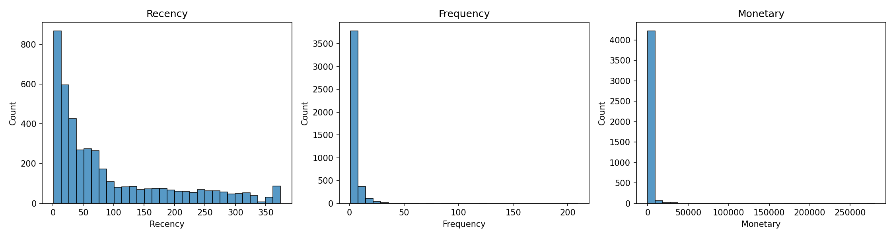
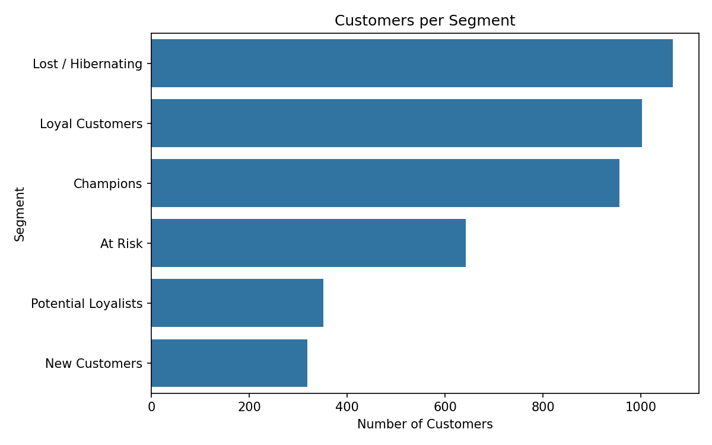
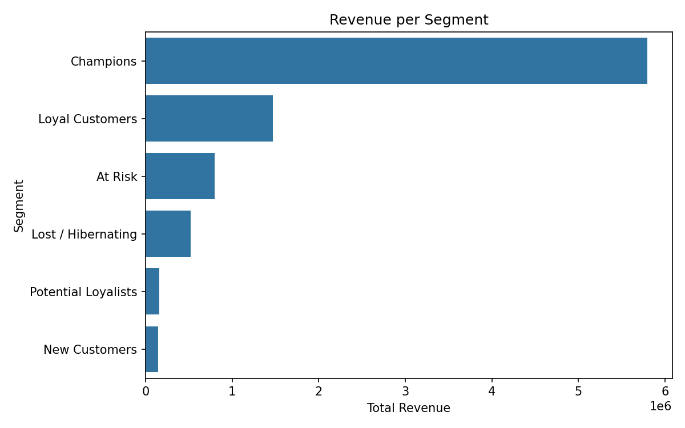

# Customer Segmentation using RFM Analysis

## Problem Statement
Businesses cannot treat all customers the same. This project groups customers
by their buying behavior using RFM (Recency, Frequency, Monetary) analysis, so
each group can be targeted with the right marketing strategy.

## Dataset
Online Retail dataset (UK online store, 2010-2011), about 541,909 transactions.
Source: https://www.kaggle.com/datasets/vijayuv/onlineretail

The dataset is not uploaded because of its size. Download it from Kaggle and
place it in a `data/` folder as `OnlineRetail.csv`.

## Methodology
1. Load and explore the data
2. Clean the data (removed missing CustomerID, cancelled invoices, negative
   quantity/price, duplicates): 541,909 -> 392,692 rows
3. Create TotalPrice = Quantity x UnitPrice
4. Set snapshot date = last invoice date + 1 day (2011-12-10)
5. Build RFM table: 4,338 customers
6. Score each of R, F, M from 1 to 5 using quintiles (Recency reversed)
7. Assign segments using rules on the scores
8. Visualize and extract business insights

## Segments and Results
| Segment | Customers | Share of revenue |
|---|---|---|
| Champions | 957 (22.1%) | 65.2% |
| Loyal Customers | 1,003 | 16.6% |
| At Risk | 643 | 9.0% |
| Lost / Hibernating | 1,065 | 5.8% |
| Potential Loyalists | 351 | 1.8% |
| New Customers | 319 | 1.6% |

## Key Insights
- Champions are 22% of customers but bring 65% of revenue (Pareto principle).
- At Risk customers (643) used to buy often but have been inactive for about
  5 months: a win-back campaign is the priority.
- Lost / Hibernating is 24.5% of customers but only 5.8% of revenue: use only
  low-cost reactivation.
- New Customers and Potential Loyalists can be nudged toward a second purchase.

## Charts




## How to Run
```
pip install -r requirements.txt
jupyter notebook rfm_analysis.ipynb
```

## Tools
Python, pandas, numpy, matplotlib, seaborn, Jupyter

## Limitations and Future Scope
- No product or demographic information is used.
- Results depend on the chosen time window.
- Future work: K-Means clustering, customer lifetime value, dashboard.
